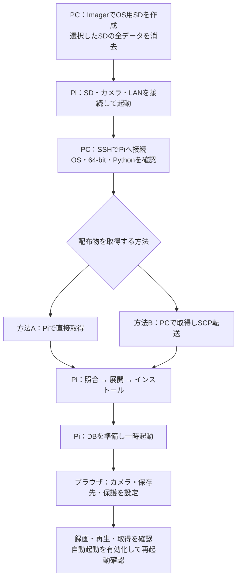
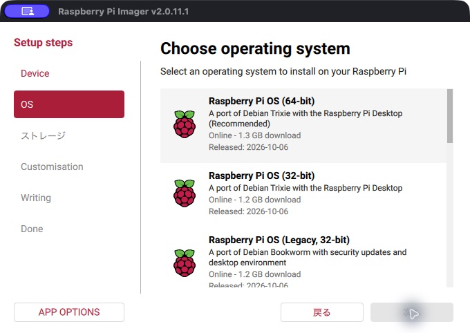
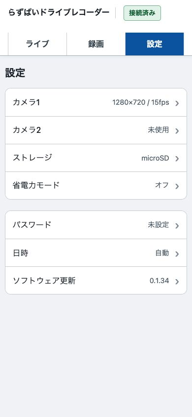
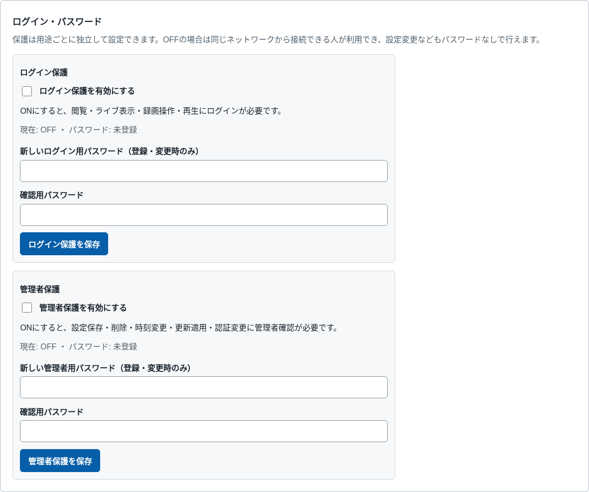
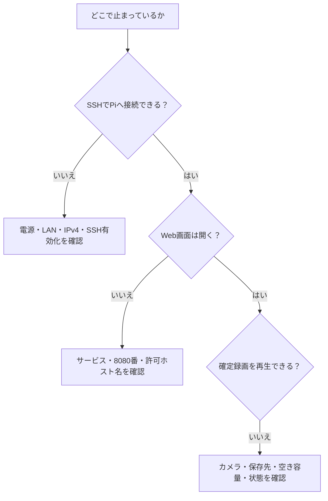

# らずぱいドライブレコーダー インストール説明書

対象：raspi-recorder 0.1.37の導入方式／GitHub Releasesの公開安定版

本書は、Windows PCまたはMacを使い、新しいRaspberry Pi 5へ導入する手順です。プログラミングは不要ですが、SD作成、LAN接続、ファイル操作、指定コマンドの入力を行います。構成とリスクは[概要説明書](概要説明書.md)、導入後の操作は[取扱説明書](取扱説明書.md)を参照してください。

**導入済みのPiを更新する場合は、SDを作り直さないでください。** 第10章の更新手順を使います。OSの書き込みは、選択したSD内のデータをすべて消去します。

## 目的から探す

| 行いたいこと | 参照先 |
|---|---|
| 必要な物を確認する | [1. 作業前の準備](#1-作業前の準備) |
| OS用SDを作る | [2. OS用microSDを作る](#2-os用microsdを作る) |
| Piへログインする | [4. PCからPiへSSH接続する](#4-pcからpiへssh接続する) |
| Piで直接ダウンロードする | [5. 方法A](#5-方法apiから直接取得して導入する) |
| PCでダウンロードして転送する | [6. 方法B](#6-方法bpcから転送して導入する) |
| 最初の起動と設定を行う | [7. 初回起動の準備](#7-初回起動の準備)・[8. ブラウザで初回設定する](#8-ブラウザで初回設定する) |
| 再起動後も自動で動かす | [9. 動作確認と自動起動](#9-動作確認と自動起動) |
| エラーを調べる | [11. 導入時のトラブル](#11-導入時のトラブル) |

## 1. 作業前の準備

### 1-1. 必要な物

- Raspberry Pi 5（メモリー4GB以上）、適切な電源・冷却。
- 消去してよいmicroSDと、PC用カードリーダー。録画量に合わせて容量と耐久性を選びます。
- Windows PCまたはMac、同じLANに接続できる環境。
- 対応するUSBカメラ1〜2台。まず1台で確認してから増やすと切り分けやすくなります。
- Piからのインターネット接続。PCで配布物を取る場合も、PiでAPT・PyPIから依存ソフトを取得します。
- 任意：ext4／exFATのUSB保存媒体。フォーマットとOS側のマウントは別の作業です。


### 1-2. 設定する名前とパスワード

| 項目 | 本書で使う例 | 説明 |
|---|---|---|
| Piのホスト名 | `raspi-recorder` | LAN内でPiを識別する名前。複数台なら異なる名前にする |
| PiのOSユーザー名 | `recorder` | SSH接続で使う。自分で決めてよい |
| PiのOSパスワード | 自分で設定 | `ssh`と`sudo`用。初期パスワードはない |
| Webログイン用パスワード | 導入後に設定 | 閲覧・録画操作用。OSパスワードとは別 |
| Web管理者用パスワード | 導入後に設定 | 設定変更・削除など用。OSパスワードとは別 |

以下の`recorder`と`raspi-recorder`は、自分の設定に置き換えます。パスワードは安全な場所で管理し、GitHubや共有資料へ書かないでください。

### 1-3. 全体の流れ



各工程で「正常な結果」を確かめてから次へ進みます。エラーを無視して次のコマンドを実行しないでください。

## 2. OS用microSDを作る

**操作する場所：PC。Piの電源は切っておきます。** この作業では選択したSDを消去します。残したい録画や設定があるSDは使用しないでください。

1. [Raspberry Pi公式サイト](https://www.raspberrypi.com/software/)から、PC用のRaspberry Pi Imagerを導入して起動します。
2. カードリーダーにmicroSDを入れます。
3. 機種で「Raspberry Pi 5」を選びます。

   

4. OS一覧で「Raspberry Pi OS (other)」を開きます。

   

5. **Raspberry Pi OS Lite (64-bit)**を選びます。説明の**Debian Trixie／13、64-bit、no desktop environment**を確認します。32-bit、Legacy、別のDebian世代を選ばないでください。

   

   見つからない場合はImagerを更新します。それでもない場合は[公式OS一覧](https://www.raspberrypi.com/software/operating-systems/)から条件に合うLite版のイメージを取得し、Imagerの「Use custom／カスタムイメージを使用」で指定します。

6. 保存先のSDを選びます。容量・機器名を確かめ、PCの内蔵ディスクやバックアップ媒体が選ばれていないことを確認します。
7. カスタマイズで次を設定します。名称や画面の順番はImagerの版によって異なります。

   | 項目 | 設定例・確認事項 |
   |---|---|
   | ホスト名 | `raspi-recorder` |
   | ユーザー名とパスワード | `recorder`と自分で決めたパスワード |
   | Wi-Fi | 使う場合、閲覧PCと同じLANのSSID・パスワード・国 |
   | タイムゾーン | 日本で使う場合は`Asia/Tokyo` |
   | キーボード | 使用する配列 |
   | SSH | 有効にする。本書ではパスワード認証の例を使用 |

8. 消去対象をもう一度確認して書き込みます。書き込みと検証が終わるまでSDを抜きません。
9. PCで安全な取り外しを行い、SDを取り出します。

**完了条件：** Imagerの書き込み・検証が成功していること。掲載のImager画像はevent logger説明書と共通の参考画像です。実際の版で表示が異なっても、選ぶOSの条件は変わりません。

## 3. Piを接続して起動する

**操作する場所：Pi。配線は電源を切った状態で行います。**

1. 作成したmicroSDをPiへ入れます。
2. USBカメラを接続します。後で同じポートを識別できるよう、差した場所を控えます。
3. 有線LANを使う場合はルーター等へ接続します。Wi-Fiの場合はImagerで設定したLANを使います。
4. USB保存先を使う場合は、準備済みの媒体を接続します。大切なデータがある媒体を初期化しないでください。
5. 適切な電源を接続して起動します。初回起動の設定が終わるまで待ちます。

接続するUSB機器が多いと、電源不足や帯域不足が起こる場合があります。必要に応じて給電方式やUSBハブを見直し、導入先で確認してください。

## 4. PCからPiへSSH接続する

### 4-1. ターミナルを開く

- Windows：スタートメニューから「ターミナル」または「PowerShell」を開きます。
- Mac：「アプリケーション」→「ユーティリティ」→「ターミナル」を開きます。

SSHは、PCからPiへ文字の命令を入力する接続方法です。次を**PCのターミナル**に入力します。

```sh
ssh recorder@raspi-recorder.local
```

初回は接続先のホスト鍵を信頼するか確認されます。対象Piまたは管理者が示す鍵の指紋と一致することを確認してから承認します。PiのOSパスワードを入力します。入力しても文字や`*`が表示されないのは通常の動作です。

**成功例：** 入力待ちが`recorder@raspi-recorder:~ $`のようなPiの表示になります。この表示自体は、次のコマンドに含めません。

`.local`で見つからない場合は、ルーターの接続機器一覧などでPiのIPv4を確認し、例えば次のように接続します。数字は自分のPiのものに置き換えます。

```sh
ssh recorder@192.168.1.50
```

ホスト鍵が変わった警告が出た場合は、別の機器への接続やなりすましも考えられます。OSを作り直した事実と新しい鍵を確認する前に、登録を削除したり、鍵の検査を無効化したりしないでください。

### 4-2. OS・Python・64-bitを確認する

**以後、第7章まではPiへSSH接続したターミナルで実行します。**

```sh
cat /etc/os-release
uname -m
python3.13 --version
hostname -s
hostname -I
```

| 確認する表示 | 正常な条件 |
|---|---|
| OS | Raspberry Pi OS相当のDebian 13、`trixie` |
| `uname -m` | `aarch64` |
| Python | `Python 3.13.x` |
| ホスト名 | Imagerで決めたもの |
| アドレス | LAN内のIPv4を控える。複数表示されることもある |

条件が異なる場合は導入を進めず、OSの選択を確認します。`aarch64`は64-bit ARMの意味です。PCや32-bit OSへ、そのまま本番用インストーラーを実行する手順ではありません。

方法Aまたは方法Bのどちらか1つを実施し、完了したら第7章へ進みます。**方法BでもPiから依存ソフトを取得するため、完全オフライン導入にはなりません。**

## 5. 方法A：Piから直接取得して導入する

**操作する場所：PiへSSH接続したターミナル。** [公式Releases](https://github.com/raspikoubou/raspi-recorder/releases/latest)の公開安定版を使用します。

配布物は次の2つです。「Source code (zip)」「Source code (tar.gz)」ではなく、**Assetsにある製品用ファイル**を使います。

| ファイル | 役割 |
|---|---|
| `raspi-recorder-X.Y.Z.tar.zst` | ソフトウェア・説明書・インストーラーをまとめたアーカイブ |
| `SHA256SUMS` | 取得ファイルの破損・取り違えを照合するための値 |

次のブロックをまとめて実行します。`X.Y.Z`を手で入力する必要はなく、公開中の安定版から読み取ります。処理に失敗すると、そのブロック内の後続処理は止まります。

```bash
(
set -eu
sudo apt-get update
sudo apt-get install -y curl zstd
recorder_install_dir="$(mktemp -d "$HOME/raspi-recorder-install.XXXXXX")"
cd "$recorder_install_dir"
curl -fL -o SHA256SUMS https://github.com/raspikoubou/raspi-recorder/releases/latest/download/SHA256SUMS
mapfile -t assets < <(awk 'NF == 2 && $2 ~ /^raspi-recorder-[0-9]+\.[0-9]+\.[0-9]+\.tar\.zst$/ { print $2 }' SHA256SUMS)
[[ "${#assets[@]}" -eq 1 ]] || { echo "配布ファイル名を確認できません" >&2; exit 1; }
archive_name="${assets[0]}"
version="${archive_name#raspi-recorder-}"
version="${version%.tar.zst}"
curl -fL -o "$archive_name" "https://github.com/raspikoubou/raspi-recorder/releases/download/v${version}/${archive_name}"
sha256sum --check --strict SHA256SUMS
mkdir extracted
tar --zstd -xf "$archive_name" -C extracted
sudo bash "$recorder_install_dir/extracted/raspi-recorder-${version}/packaging/install.sh" "$recorder_install_dir/extracted/raspi-recorder-${version}"
)
```

**途中の確認：** アーカイブ名の後に`OK`が出ます。`FAILED`、404、通信エラーなどが出た場合は照合・取得に失敗しています。第11章で確認し、そのまま展開や導入だけを手動実行しないでください。

**完了の表示：** `Installed X.Y.Z. Services are not enabled or started.`と表示され、エラーなく入力待ちへ戻ります。これは「導入済み・サービスは未起動」という意味です。初回の依存ソフト構築には時間がかかります。途中で電源を切らないでください。第7章へ進みます。

SHA256SUMSは電子署名ではなく、配布者の本人確認までは行いません。公式の同じReleaseから取得し、出所を確認してください。

## 6. 方法B：PCから転送して導入する

### 6-1. PCで配布物2点を取得する

**操作する場所：PCのブラウザ。** [公式Releases](https://github.com/raspikoubou/raspi-recorder/releases/latest)を開き、同じ公開安定版のAssetsから、`raspi-recorder-X.Y.Z.tar.zst`と`SHA256SUMS`を取得します。ファイル名を変更せず、同じフォルダーに保存します。

以下の`X.Y.Z`は、取得した実際のバージョン番号に置き換えます。ブラウザがファイル名に`(1)`や`.txt`を付けた場合は、取り違えがないことを確認し、正しい名前の2点を用意してください。

### 6-2. PCからPiへ送る

**操作する場所：PCのターミナル。PiへSSH接続中の画面ではありません。** 新しいターミナルを開くと区別できます。

まずPiに転送先フォルダーを用意します。

```sh
ssh recorder@raspi-recorder.local 'mkdir -p ~/raspi-recorder-install'
```

WindowsのPowerShellで「ダウンロード」へ保存した場合：

```powershell
scp "$HOME\Downloads\SHA256SUMS" "$HOME\Downloads\raspi-recorder-X.Y.Z.tar.zst" recorder@raspi-recorder.local:raspi-recorder-install/
```

Macで「ダウンロード」へ保存した場合：

```sh
scp "$HOME/Downloads/SHA256SUMS" "$HOME/Downloads/raspi-recorder-X.Y.Z.tar.zst" recorder@raspi-recorder.local:raspi-recorder-install/
```

保存場所が違う場合は、PC上のパスを変更します。Piの名前で接続できない場合は、SSH接続で確認したIPv4へ置き換えます。パスワードはPiのOSパスワードです。

**完了条件：** 2つのファイルの転送が完了し、エラーがないこと。

### 6-3. Piで照合・展開・導入する

**操作する場所：PiへSSH接続したターミナル。** 必要なら第4章の`ssh`で接続し直します。次をまとめて実行します。

```bash
(
set -eu
sudo apt-get update
sudo apt-get install -y zstd
cd "$HOME/raspi-recorder-install"
mapfile -t assets < <(awk 'NF == 2 && $2 ~ /^raspi-recorder-[0-9]+\.[0-9]+\.[0-9]+\.tar\.zst$/ { print $2 }' SHA256SUMS)
[[ "${#assets[@]}" -eq 1 ]] || { echo "配布ファイル名を確認できません" >&2; exit 1; }
archive_name="${assets[0]}"
version="${archive_name#raspi-recorder-}"
version="${version%.tar.zst}"
sha256sum --check --strict SHA256SUMS
recorder_extract_dir="$(mktemp -d "$PWD/extracted.XXXXXX")"
tar --zstd -xf "$archive_name" -C "$recorder_extract_dir"
sudo bash "$recorder_extract_dir/raspi-recorder-${version}/packaging/install.sh" "$recorder_extract_dir/raspi-recorder-${version}"
)
```

照合時に`OK`、最後に`Installed X.Y.Z. Services are not enabled or started.`と出ることを確認します。エラーがあれば先へ進みません。

インストーラーはPiでAPT・PyPIへ接続し、固定版の依存ソフトをソースから構築します。PCでアーカイブを取得しただけでは、依存ソフトは揃いません。Piがインターネットへ接続できない場合は、この手順では導入を完了できません。

## 7. 初回起動の準備

### 7-1. インストーラーが行うこと

インストーラーは対応OS・Python・アーキテクチャーと配布ファイルを検査し、必要なOSパッケージ、専用ユーザー、バージョン別のプログラム、systemdサービスを用意します。既存の録画・設定・認証情報を削除したり、媒体をフォーマットしたりしません。想定外の既存ファイルを見つけた場合は停止します。

**engine／Webサービスは自動起動しません。** 次で導入した版を確認します。

```sh
sudo -u raspi-recorder /opt/raspi-recorder/current/.venv/bin/raspi-recorder --version
```

取得したReleaseの番号と一致すれば次へ進みます。

### 7-2. データベースを準備して一時起動する

**操作する場所：PiのSSHターミナル。** 次のブロックをまとめて実行します。長いコードですが、認証用ファイルの種類と権限を確認し、録画・設定・登録済みパスワードを消さずに準備するための手順です。

```bash
(
set -e
sudo systemctl stop raspi-recorder-engine.service raspi-recorder-web.service

auth_db=/var/lib/raspi-recorder/authentication.sqlite3
sidecars=("${auth_db}-wal" "${auth_db}-shm")

validate_auth_files() {
  for path in "$auth_db" "${sidecars[@]}"; do
    if sudo test -L "$path"; then
      echo "Refusing a symbolic link in the authentication database path: $path" >&2
      return 1
    fi
    if sudo test -e "$path" && ! sudo test -f "$path"; then
      echo "Refusing a non-regular authentication database file: $path" >&2
      return 1
    fi
  done
}
validate_auth_files

if ! sudo test -e "$auth_db"; then
  for sidecar in "${sidecars[@]}"; do
    if sudo test -e "$sidecar"; then
      echo "Found an SQLite sidecar without its database: $sidecar" >&2
      exit 1
    fi
  done
fi

# initialize runs as the engine account. Keep every authentication file private
# while temporarily returning any existing database and sidecars to that owner.
for path in "$auth_db" "${sidecars[@]}"; do
  if sudo test -e "$path"; then
    sudo chown raspi-recorder:raspi-recorder "$path"
    sudo chmod 0600 "$path"
  fi
done

sudo -u raspi-recorder /opt/raspi-recorder/current/.venv/bin/raspi-recorder initialize

validate_auth_files
if ! sudo test -f "$auth_db"; then
  echo "Authentication initialization did not create a regular database file" >&2
  exit 1
fi
for path in "$auth_db" "${sidecars[@]}"; do
  if sudo test -e "$path"; then
    sudo chown raspi-recorder-web:raspi-recorder "$path"
    sudo chmod 0600 "$path"
  fi
done

sudo systemctl start raspi-recorder-engine.service raspi-recorder-web.service
sudo systemctl status --no-pager raspi-recorder-engine.service raspi-recorder-web.service
)
```

新規の場合は「Web画面をパスワード登録なしで利用できます」、既存の場合は「既存設定を保持しました」と表示されます。最後に2つのサービスが`active (running)`であることを確認します。

途中で失敗した場合は、`systemctl status`でengineとWebの両方を確認し、両方を停止してから原因を直します。DBを削除してやり直す必要はありません。初回の準備とサービスの起動を終えた時点で、保存済み設定に従って録画処理が動き始めます。まだカメラ未登録なら録画を開始できない表示になります。

### 7-3. Web画面を開くアドレスを確認する

**操作する場所：PC・スマートフォンのブラウザ。** Piと同じLANにつなぎ、検索欄ではなく**アドレス欄**に入力します。

```text
http://raspi-recorder.local:8080/
```

ホスト名を変えた場合は、その名前に置き換えます。`http://`と`:8080`を含めます。HTTPSのURLではありません。

インストーラーは導入時のホスト名・その`.local`名・`localhost`をWebの許可名に登録します。**初期状態でLANのIPアドレスを直接入力すると、Host検査で拒否される場合があります。** `.local`が使えない環境やIPv4で利用したい場合は、次の手順で明示的に追加します。

#### IPv4を追加する場合

**操作する場所：PiのSSHターミナル。** `hostname -s`と`hostname -I`で実際の名前・IPv4を確認します。次で追加設定を開きます。

```sh
sudo nano /etc/systemd/system/raspi-recorder-web.service.d/20-access.conf
```

次はホスト名`raspi-recorder`、IPv4`192.168.1.50`の場合の**記入例**です。自分の名前・IPv4へ置き換えます。ホスト名の既存設定ファイル`10-trusted-hosts.conf`は変更しません。

```ini
[Service]
Environment=RASPI_RECORDER_TRUSTED_HOSTS=raspi-recorder,raspi-recorder.local,localhost,192.168.1.50
```

Control＋O、Enterで保存し、Control＋Xで終了します。続いて実行します。

```sh
sudo systemctl daemon-reload
sudo systemctl restart raspi-recorder-web.service
```

Webの接続は一度切れます。engineは独立して動作します。ブラウザで`http://192.168.1.50:8080/`を開きます。ルーターから割り当てるIPv4が変わると追加設定も見直す必要があります。固定割当て等を使う場合はLAN管理者へ確認してください。`*`で全ホストを許可する設定にしないでください。

## 8. ブラウザで初回設定する

新規導入時はログイン保護・管理者保護がOFFで、初期パスワードはありません。**初回設定は第三者が接続できない信頼できるLANで行ってください。** 保護OFFのまま通常運用すると、接続可能な人が閲覧・停止・設定変更・削除できます。

### 8-1. カメラとストレージ

1. 上部の「設定」を押し、項目の一覧を開きます。
3. 「ストレージ」でmicroSDまたは準備したUSBを選び、保存します。USBが出ない場合はマウント・形式・UUID・権限を確認します。
4. 「カメラ1」で使用するカメラと録画品質を選びます。初めは音声OFFで映像を確認します。
5. 日時表示の有無・位置・大きさを選び、「設定を保存」を押します。録画の中断や管理者確認が出たら内容を確認します。
6. 「設定を保存しました。」を確認します。成功すると項目一覧へ戻ります。
7. 2台目を使う場合は「カメラ2」も設定します。1台だけなら「使用しない」のままにします。



設定変更では録画の確定や再開に時間がかかり、録画空白が生じる場合があります。保存先切替では旧媒体の録画を自動移動しません。1台構成ではカメラ2に「使用していません」と表示されます。カメラ1の実際の録画状態を確認してください。

### 8-2. パスワード保護

「設定」→「パスワード」を開き、対象の保護を押して詳細へ進みます。

1. 「ログイン保護を有効にする」にチェックし、新しいログイン用パスワードと確認用を同じ内容で入力します。
2. 「ログイン保護を保存」を押します。ログイン画面に切り替わったら、新しく決めたパスワードで入り直します。
3. 設定を開き直し、「管理者保護を有効にする」にチェックし、管理者用パスワードと確認用を入力します。
4. 「管理者保護を保存」を押します。以後、重要な操作で管理者の確認が出ます。

パスワードは8〜128文字です。他サービスやOSのパスワードを使い回さず、推測しにくいものを別々に決めます。録画設定の「設定を保存」と、各保護の「保存」は別の操作です。



*保護が両方OFFの設定例です。運用時にOFFを推奨する画像ではありません。*

Web画面はHTTPです。保護をONにしても通信は暗号化されません。信頼できるLANまたは保護されたVPN内だけで利用し、8080番をインターネットへ直接公開しないでください。

### 8-3. 時計を確認する

「設定」→「日時」でPiの日時・タイムゾーン・NTPの状態を確認します。NTPはネットワークで時計を合わせる仕組みです。「時刻同期を確認できません」と出る場合、正確に同期しているとは判断しません。

日本で使う場合、OSのタイムゾーンは`Asia/Tokyo`です。違っている場合は、録画への影響を確認したうえで設置担当者がOS側を設定します。Web画面にはタイムゾーンを選び直す機能はありません。詳しくは[取扱説明書 第7章](取扱説明書.md#7-時刻とソフトウェア更新)を参照してください。

## 9. 動作確認と自動起動

### 9-1. 最初の短い録画を確認する

1. 「ライブ」を開き、対象カメラの画像が更新されることを確認します。
2. 対象カメラに「録画中」と表示され、停止理由が出ていないことを確認します。
3. 少し録画した後、そのカメラの「録画を停止」を押し、「停止中」になるまで待ちます。進行中のファイルを確定させるための操作です。
4. 「録画」を開き、日付と対象の録画時間を選びます。
5. 表示された再生画面で映像を確認します。音声を有効にした場合は、音声も確認します。
6. 「ダウンロード」でPCへMP4を保存し、取得したコピーも再生できることを確認します。
7. 「ライブ」へ戻り、「録画を再開」を押します。「録画中」へ戻ることを確認します。


### 9-2. 自動起動を有効にする

**操作する場所：PiのSSHターミナル。** カメラ・保存先・保護の確認が終わったら実行します。

```sh
sudo systemctl enable --now raspi-recorder-engine.service raspi-recorder-web.service
systemctl is-enabled raspi-recorder-engine.service raspi-recorder-web.service
systemctl is-active raspi-recorder-engine.service raspi-recorder-web.service
```

`is-enabled`は2行とも`enabled`、`is-active`は2行とも`active`が正常です。これだけでは映像の保存成功までは保証しません。第9-1節の確認も必要です。

### 9-3. 再起動後も確認する

必要な録画を保存し、録画を確定させてからPiを再起動します。

```sh
sudo reboot
```

SSHは切断されます。Piの起動後、ブラウザを再読み込みします。**Pi本体の再起動では、手動停止が解除され、設定済みのカメラで録画を自動開始します。** 意図せず再開して困る撮影場所では、再起動前に運用を確認してください。

| 導入完了の確認項目 | 完了条件 |
|---|---|
| Web接続 | 許可したホスト名／IPv4で画面が開く |
| 保護 | ログイン保護・管理者保護が意図したON/OFFになっている |
| 時計 | 日時・タイムゾーン・同期状態を確認できた |
| カメラ | 使用する各カメラで実画像と録画状態が正常 |
| ファイル | 確定済み録画を再生し、ダウンロードしたコピーも確認できた |
| 保存容量 | 選んだ媒体と自動削除の値が運用に合っている |
| 再起動 | 自動起動し、必要な録画が再開する |

未確認の項目を残したまま、確実な録画が必要な運用へ移らないでください。

## 10. 導入後の更新・停止・データ管理

### 10-1. 安定版へ更新する

「設定」→「ソフトウェア更新」→「安定版を確認」で公開安定版を確認します。現在より新しい候補の番号・変更点・容量を読み、必要なら適用します。確認だけでは更新しません。Draft、Pre-release、同じ版は更新候補になりません。

更新元は`raspikoubou/raspi-recorder`に固定されています。Web更新は公開Releaseを認証情報なしで取得します。トークンや別リポジトリを登録する手順はありません。

更新前に重要な録画を退避します。配布物の取得・検証・依存構築の後、最終切替で録画とWebが一時停止します。電源を切らず、接続が戻るまで待ちます。失敗時は旧版への復帰を試みますが、どのような故障でも復旧できる保証はありません。操作の状態確認、復旧時の注意は[取扱説明書 第7章](取扱説明書.md#7-時刻とソフトウェア更新)を参照してください。

### 10-2. 電源を切る

1. ライブ画面で、使用中の各カメラの「録画を停止」を押します。
2. 確定処理が終わり、停止状態になったことを確認します。
3. PiへSSH接続し、次を実行します。

```sh
sudo shutdown -h now
```

SSH切断だけでは停止完了の確認になりません。Pi本体のOS終了と待機状態を、機器の表示や[公式の説明](https://www.raspberrypi.com/documentation/computers/configuration.html#raspberry-pi-5-and-500-leds)で確認してから電源を外します。判断できない場合は抜かず、設置担当者へ確認します。録画停止ボタンは、Piの電源OFFやUSB媒体の安全な取り外しではありません。

### 10-3. 保存場所と削除

| 場所 | 主な内容 |
|---|---|
| `/opt/raspi-recorder` | バージョン別プログラムと現在版へのリンク |
| `/var/lib/raspi-recorder` | 設定、認証、録画一覧のDB、microSD録画など |
| `/var/lib/raspi-recorder/media/recordings/` | microSDを選んだ場合の録画 |
| USB媒体の`raspi-recorder/recordings/` | そのUSB媒体を選んだ場合の録画 |
| `/var/lib/raspi-recorder-update` | 更新の復旧情報・一時的なDBバックアップなど |

本ソフトに一括アンインストール機能はありません。利用を止めるだけなら、録画を確定させてから次で停止・自動起動を解除できます。

```sh
sudo systemctl disable --now raspi-recorder-web.service raspi-recorder-engine.service
```

録画・設定・認証DBは残ります。プログラムやsystemd設定まで削除する作業は、導入物と保存データを区別できる管理者が行います。`/var/lib/raspi-recorder`やUSBのアプリ領域を削除するとデータを失います。復旧目的でDB・所有マーカー・更新の復旧情報を削除しないでください。

## 11. 導入時のトラブル



| 症状 | 確認すること |
|---|---|
| `.local`が見つからない | PCとPiが同じLANか、ゲストWi-Fiで端末間通信が遮断されていないか。ルーターでIPv4を確認 |
| SSHで接続拒否 | Piの起動、ImagerのSSH有効化、IP、ポート・LAN制限 |
| SSHの認証失敗 | OSユーザー名とOSパスワード。Web用とは別 |
| ダウンロードが404／403 | 公式の同じ公開安定版か、Assetsの正確な名前か、ネットワーク制限がないか |
| checksumが`FAILED` | 導入せず、2点を同じReleaseから取得し直す。照合を省略しない |
| `tar --zstd`が失敗 | `zstd`が導入済みか、アーカイブが正しく取得されているか |
| 対応OS等のエラー | Debian 13／Trixie、Python 3.13、`aarch64`か |
| APT・Python構築が失敗 | Piからのインターネット接続、空き容量、電源・冷却、表示された最初のエラー |
| 既存パスを上書きしないと言われる | 手編集や別の導入物がないか確認。削除で強行せず内容を調べる |
| Webが開かない | サービス、現在のホスト名、`:8080`、HTTP、同じLANか |
| `Host`に関する400エラー | 第7-3節の許可ホスト名／IPv4追加設定を確認 |
| USB保存先が出ない | ext4／exFAT、OSのマウント、UUID、書込権限、所有マーカーの状態。形式変更は別作業 |
| 映像は見えるが録画されない | ライブの「録画状態」「確認事項」、カメラ・保存先・容量を確認 |
| 2台目が未接続 | 1台運用なら未登録のカメラ2の注意と、使用中カメラの異常を区別する |
| ログインできなくなった | [取扱説明書のローカル認証初期化](取扱説明書.md#6-4-パスワードを忘れた場合)へ |

Piでサービス状態を見るコマンド：

```sh
sudo systemctl status --no-pager raspi-recorder-engine.service raspi-recorder-web.service raspi-recorder-update-recover.service
```

最近のログを見るコマンド：

```sh
sudo journalctl -u raspi-recorder-engine.service -u raspi-recorder-web.service -n 100 --no-pager
```

更新処理のログも調べる場合：

```sh
sudo journalctl -u 'raspi-recorder-update@*' -u raspi-recorder-update-recover.service --since today --no-pager
```

不具合を報告する場合は、版番号・OS・カメラ等の機器名・行った操作・エラー・直前の変更を記録します。パスワード、Wi-Fi情報、設備の機密、撮影された個人情報、不要なアドレスなどは共有前に除きます。ログや映像をそのまま公開しないでください。

## 12. 導入・運用に関する注意と免責

本ソフトは[MIT License](../../LICENSE)に基づき現状のまま提供されます。法令で認められる範囲で動作や特定用途への適合性を保証せず、利用等に起因する損害について著作者・著作権者は責任を負いません。正式な条件はLICENSEを確認してください。

録画の欠落・破損・消失、停止、誤った時刻、設定変更や更新時の録画空白、更新・復旧失敗のリスクがあります。重要な映像を別媒体へ保存し、導入先の実機で確認してください。安全装置・非常停止・設備保護の代わりには使用しないでください。

初期状態の保護はOFF、通信はHTTP、保存媒体はアプリで自動暗号化されません。第三者が接続できないLANで導入し、運用前に保護とアクセス経路を確認します。撮影・録音する範囲、関係者の同意、保存期間と持ち出し先も管理してください。詳しくは[概要説明書 第7・8章](概要説明書.md#7-セキュリティとプライバシー)と[取扱説明書](取扱説明書.md)を参照してください。

スクリーンショットの出所・撮影条件は[画像について](images/manual/README.md)に記載しています。
