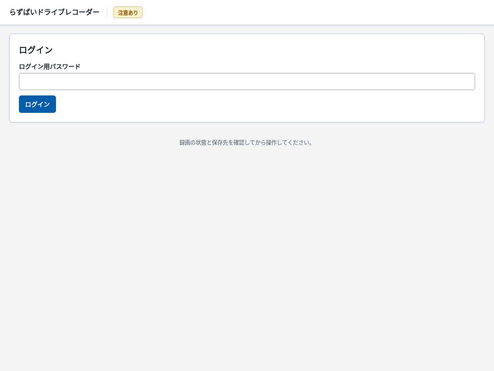
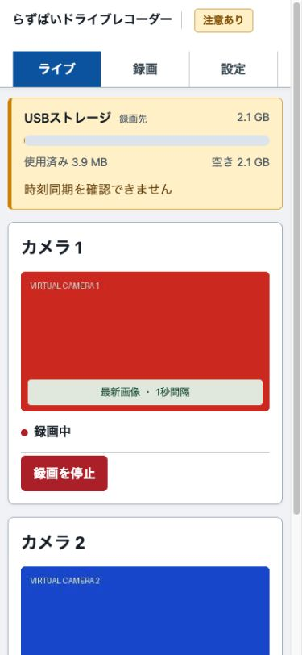
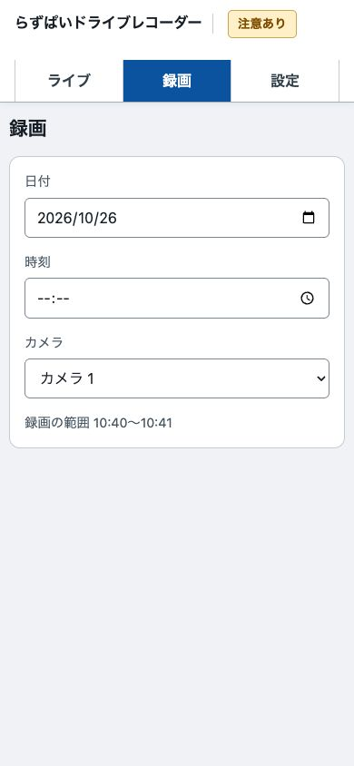
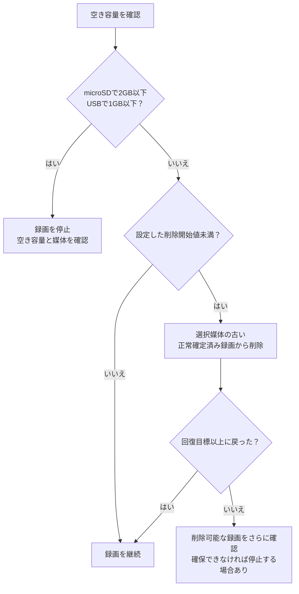
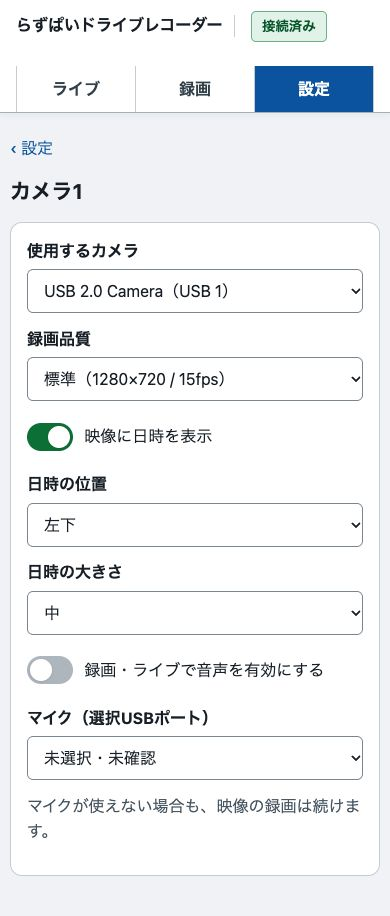
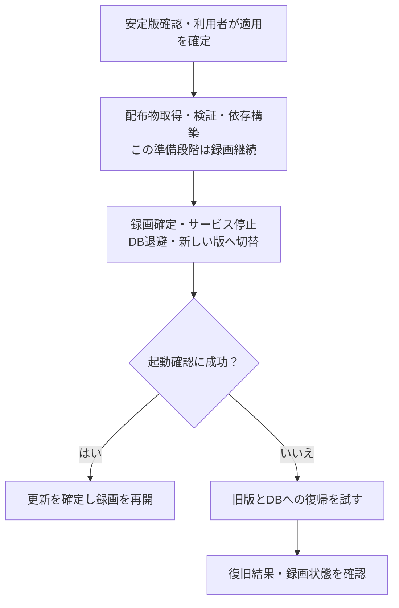

# らずぱいドライブレコーダー 取扱説明書

対象：現行開発版の画面・機能。導入する版の配布条件はReleaseの説明を確認してください。

本書は、導入済みの機器の画面操作・設定・日常点検を説明します。必要機器と使用条件は[概要説明書](概要説明書.md)、OS作成や初回導入は[インストール説明書](インストール説明書.md)を参照してください。


## 目的から探す

| 行いたいこと | 参照先 |
|---|---|
| 使う前の注意を読む | [1. 大切な注意](#1-大切な注意) |
| PC・スマートフォンから画面を開く | [2. 接続と共通操作](#2-接続と共通操作) |
| 現在画像・録画状態を確認する／停止・再開する | [3. ライブ画面](#3-ライブ画面) |
| 過去の録画を探す・再生する・保存する | [4. 録画を探す・再生する・持ち出す](#4-録画を探す再生する持ち出す) |
| カメラ、音声、省電力、保存先を変える | [5. 設定を変更する](#5-設定を変更する) |
| パスワード保護を設定する／忘れた | [6. セキュリティとパスワード](#6-セキュリティとパスワード) |
| 時計を合わせる／ソフトを更新する | [7. 時刻とソフトウェア更新](#7-時刻とソフトウェア更新) |
| 毎日の点検、USB取り外し、電源OFF | [8. 日常点検・バックアップ・停止](#8-日常点検バックアップ停止) |
| 困った症状を調べる | [9. 症状から探す](#9-症状から探す) |
| 用語を調べる | [10. 用語](#10-用語) |

## 1. 大切な注意

### 1-1. 録画と機器の安全

本ソフトは一般用途の映像記録用です。安全装置・非常停止・人身安全・設備保護に必要な動作や信頼性を保証しません。必要な停止・保護は、独立した機器・回路で実現してください。これはMIT Licenseに用途制限を追加するものではありません。

停電、電源不足、過熱、媒体の故障・寿命、USB切断、容量不足、処理負荷、ソフト・OSの停止、誤操作などにより、映像・音声が欠落・破損・消失したり、録画が止まったりする場合があります。欠落が必ず警告で検出されるわけではありません。自動再開・更新時の復旧も成功を保証しません。

**重要な映像は早めに別の媒体へ保存し、そのコピーを再生してください。** アプリ内の録画は、自動削除や手動削除の対象になります。重要録画を固定して残す機能はありません。

### 1-2. ネットワークとプライバシー

Web画面はHTTPで、通信は暗号化されません。パスワード保護をONにしても盗聴・改変のリスクは残ります。信頼できるLANまたは保護されたVPN内で使用し、8080番をインターネットへ直接公開しないでください。

新規導入時のログイン保護・管理者保護はOFFです。接続可能な人が、映像の閲覧・持ち出し・録画の停止・設定変更・削除を行える状態です。運用前に[第6章](#6-セキュリティとパスワード)を確認してください。

撮影・録音に必要な同意や掲示、保存期間、閲覧権限、持ち出し先を設置者が管理します。撮影した人の顔、会話、設備や作業の機密情報が映像や音声に含まれる場合があります。USB・microSDやダウンロードしたファイルも適切に保管してください。アプリは保存媒体や取得ファイルを自動暗号化しません。

### 1-3. 免責と保証の範囲

本ソフトウェアは[MIT License](../../LICENSE)に従い現状のまま提供されます。法令で認められる範囲で、商品性・特定目的への適合性・権利非侵害などを保証せず、利用等に起因する損害について著作者・著作権者は責任を負いません。正式な条件はLICENSE本文を確認してください。

説明書・画面の状態・検証結果は、無欠陥、無停止、録画の完全性、時刻の正確性、映像の証拠能力、改ざんがないことを保証しません。導入先の機器と運用で確認し、必要なバックアップや独立した対策を設けてください。

## 2. 接続と共通操作

### 2-1. ブラウザで開く

Piと同じLANにPC・スマートフォンを接続し、ブラウザのアドレス欄へ、導入時に控えたURLを入力します。

```text
http://raspi-recorder.local:8080/
```

ホスト名が異なる場合は置き換えます。IPv4で開く場合は、そのIPv4をWebの許可ホストへ追加しておく必要があります。初期設定のままIPで開けない場合は、[インストール説明書 第7-3節](インストール説明書.md#7-3-web画面を開くアドレスを確認する)を参照してください。

ログイン保護がONなら、ログイン用パスワードを入力します。OS／SSH用や管理者用のパスワードとは別です。



ブラウザやWebサービスが切断されても、独立した録画engineが動作していれば録画は続きます。画面に接続できない場合は、録画が継続しているとも停止したとも断定せず、Pi側の状態を確認します。

画面の初回読み込みに失敗した場合は「読み込み直す」で再試行できます。ライブで通信が途切れた場合は「録画状態を確認できません」と表示し、停止・再開などの操作を一時的に無効にします。接続が戻ると自動で状態を確認します。

### 2-2. 3つの画面

| 上部のボタン | 用途 |
|---|---|
| ライブ | 最新画像、録画状態、カメラ別の停止・再開 |
| 録画 | 日付と時間から映像を選び、再生・ダウンロード |
| 設定 | カメラ、保存先、認証、日時、更新 |

スマートフォンではカメラカードが縦に並びます。下のカメラやボタンはスクロールして表示します。小さい画面でも「ライブ」「録画」「設定」は上部から選べます。



### 2-3. 操作の基本

- 上部の容量表示と、対象カメラの「録画中」「停止中」などの表示を確認します。問題がある場合は、その理由も表示します。
- 設定画面の項目を変えただけでは保存されません。変更後に現れる「設定を保存」、または各機能の保存ボタンを押し、成功表示を確認します。
- 重要な操作では確認画面が出ます。対象カメラ・件数・中断の影響を読み、意図と違う場合はキャンセルします。
- 管理者保護がONなら、必要な操作で「管理者の確認」が出ます。確認の有効時間は10分です。
- エラーや処理中表示が出た場合は連打せず、結果を確認します。別の人・端末による設定変更で競合した場合は、現在の設定を読み直してから操作します。
- ブラウザを更新したり別画面へ移ったりすると、未保存の入力を失う場合があります。移動前に保存の結果を確認してください。

## 3. ライブ画面

### 3-1. 画面の見方


| 場所 | 読み方 |
|---|---|
| 上部の容量表示 | 接続中のmicroSD・USBそれぞれの合計・使用済み・空き容量。録画先には印を表示 |
| カメラの画像 | 通常は1秒ごとに更新する最新画像 |
| 「録画中」「停止中」などの表示 | 実際の動作状態。録画成功の確認ではまずここを見る |
| 停止理由 | カメラ・保存先・容量・設定などに問題がある場合に表示 |
| 録画を停止／再開 | そのカメラの録画希望を変更する |
| 設定を確認する | 設定の確認が必要な場合に表示する案内 |

画像が更新されていても、録画停止中の場合があります。通常の画像表示は録画と独立しており、停止中でも表示に必要なカメラ取得が動く場合があります。画像が見えるだけで、MP4へ保存できているとは判断しません。

### 3-2. 録画状態の意味

| 表示 | 意味・次に確認すること |
|---|---|
| 準備中 | カメラや録画の準備中。長く続くなら設定・機器・負荷を確認 |
| 録画中 | 常時録画が動作している。定期的に保存済み録画も確認 |
| 録画ファイルを確定中 | MP4を閉じ、保存結果を確定している。電源や媒体を抜かない |
| 停止中 | 手動停止などで録画していない |
| 録画を開始できません | カメラ・保存先・容量・設定などの障害がある。「確認事項」を読む |
| 確認が必要です | エラーがある。理由・ログを確認し、正常と判断しない |

再開を指示しても、カメラがない・媒体が使えないなどの理由で録画できない場合があります。使わないカメラは「使用していません」と表示します。

### 3-3. カメラ別に止める・再開する

1. 対象カメラの番号を確認します。
2. 「録画を停止」を押します。
3. 確定処理が終わり「停止中」になることを確認します。
4. 再開するときは同じカメラの「録画を再開」を押します。


**停止状態の保持：** 同じPi起動中に録画engineだけを再起動した場合、手動停止は保持します。Pi本体を再起動した場合は手動停止が解除され、保存済み方式で自動開始します。

### 3-4. 通常の画像更新と音声付きライブ

通常表示は最大幅640pxのJPEGを1秒間隔で更新します。録画の解像度・fpsとは別です。画面で動きが粗く見えても、それだけで録画fpsが1になっているわけではありません。別画面へ移る、タブを隠すなどすると不要な画像取得を止めます。

音声付きライブを利用する場合：

1. 「設定」で対象カメラのマイクを選び、「録画・ライブで音声を有効にする」を保存します。
2. 「ライブ」へ戻り、対象の「音声付きライブを準備」を押します。
3. 準備が終わったら、表示された動画プレイヤーの再生ボタンを押します。端末のミュート・音量も確認します。

音声が無効ならボタンは表示されません。対応する音声入力とブラウザが必要で、配信には遅延があります。音声取得に失敗しても映像だけの録画が続く場合があるため、重要な音声は実際の録画を再生して確認してください。

## 4. 録画を探す・再生する・持ち出す

### 4-1. 日付と時刻を選ぶ

1. 上部の「録画」を押します。
2. 「日付」で見たい日を選びます。最初は最新の録画がある日が選ばれます。
3. 「時刻」で見たい時刻を指定します。2台分ある場合は「カメラ」も選びます。
4. その時刻を含む録画の再生画面と「ダウンロード」が表示されます。該当する録画がない場合は、その旨を表示して最も近い録画を開きます。



ファイルが増えても、長い候補一覧をスクロールする必要はありません。日付を変えると再生を止め、選択中の時刻を保って新しい日の録画を探します。読み込み中・録画がない日・通信エラー時も時刻を変更できます。録画がない日は「この日の録画はありません。」と表示し、通信エラー時は「読み込み直す」で再試行できます。

日時はPiのOSタイムゾーンを基準に表示します。日をまたぐ録画は両日から選べ、別日の時刻には月日も表示します。まだ保存を確定していない録画と、接続していない媒体の録画は選べません。

### 4-2. 再生・ダウンロード

時刻を指定すると、その録画ファイルの先頭から再生が始まります。前後のファイルへは「前の録画」「次の録画」で移動できます。ファイル内は再生バーで位置を移動します。最初はミュートのため、音声を確認するときはミュートを解除し、端末の音量も確認してください。

「ダウンロード」を押すと、その録画をMP4で保存します。保存先は端末・ブラウザに従います。重要な映像は自動削除される前に保存し、取得したコピーも再生してください。

「要確認」の録画は正常に保存されていない可能性があります。残存ファイルをダウンロードできる場合がありますが、再生や内容の完全性は保証しません。通常の録画をブラウザで再生できない場合も、ダウンロードしてH.264対応のプレイヤーで確認してください。

## 5. 設定を変更する

### 5-1. 保存する手順と録画への影響

「設定」を開くと、項目名と現在の設定が表示されます。変更したい項目を押すと、その設定だけが開きます。


1. 「カメラ1」「カメラ2」「ストレージ」「省電力モード」から変更する項目を選びます。
2. 値を変更すると、画面下に「設定を保存」が現れます。
3. 保存を押し、録画の中断や管理者確認が表示されたら内容を確認します。

保存中は入力と画面の移動を止め、完了後に操作できるようになります。読み込みに失敗した場合は「読み込み直す」で再試行できます。日時・更新情報だけを取得できない場合も、ほかの設定は開けます。
4. 成功すると設定一覧へ戻り、「設定を保存しました。」と表示されます。
5. 保存せずに戻るときは、左上の「設定」を押して変更の破棄を選びます。変更を元の値に戻した場合は確認なしで戻れます。

パスワード、日時、ソフトウェア更新も、同じ一覧から個別に開きます。各画面の専用ボタンで操作します。

| 変更する内容 | 主な影響 |
|---|---|
| 省電力、保存先など全体の変更 | 複数カメラへ影響。確認に表示された範囲を読む |
| 日時焼き込みのON/OFF・位置・大きさ | ライブは次の生成画像から、録画は次の物理ファイルから反映 |
| パスワード保護 | 専用の保存ボタンを使用。認証状態が変わり再ログインになる場合がある |
| ソフトウェア更新 | 最終切替時に録画とWebが一時停止 |

変更後の起動に失敗すると、旧設定へ戻して再開を試みる場合があります。「保存ボタンを押した」だけで完了と判断せず、結果と録画状態を確認します。

### 5-4. 省電力モード

「設定」→「省電力モード」の「省電力モード」は初期OFFです。


ONにすると、カメラが対応する設定の中から、通常設定を超えない解像度・fpsを選び、録画・ライブの音声をOFFにします。通常設定は保持され、OFFに戻すと復帰します。変更は「設定を保存」で保存します。

低い対応設定がなければ解像度・fpsは変わらず、理由が表示されます。消費電力や発熱がどれだけ減るか、必要な瞬間を残せるかは、実機と用途で確認します。低fpsでは動きの細部を取りこぼすリスクが増えます。

### 5-5. 保存先と容量管理

「設定」→「ストレージ」を開きます。容量の閾値は「自動削除」を押すと変更できます。

| 項目 | 初期値・意味 |
|---|---|
| 保存先 | microSD。対応するUSB媒体へ変更可能 |
| 自動削除を始める空き容量 | 初期5GB。これを下回ると削除開始 |
| 自動削除後の回復目標 | 初期7GB。削除開始後、この空き以上へ戻すまで削除を試す |

GBは10進単位で、1GB＝1,000,000,000バイトです。設定刻みは0.1GBです。削除開始はmicroSDで2GBより大きく、USBで1GBより大きくし、回復目標は削除開始より大きく、媒体の実容量以下にします。



対象はアプリの管理領域にある録画です。録画中・読み取り利用中・管理対象外などは削除できず、異常録画は自動削除しません。削除できないファイルや他のデータが容量を使っていると、回復できないことがあります。自動削除をバックアップの代わりにしないでください。

USB保存先の条件：

- ext4またはexFAT。FAT32／NTFSは非対応。
- OSがマウント済みで、録画engineのユーザーが書き込みできること。
- UUIDを一意に確認できること。番号やUSB差込口だけで媒体を識別しないこと。
- アプリの所有マーカーと専用領域を確認できること。既存の同名フォルダーを無条件に引き取らないこと。

USBの既存データは録画管理の対象外です。アプリはUSBをフォーマットしません。Lite OSでは自動でマウントされないことがあるため、UUIDを使った永続マウント・権限は設置担当者が準備します。デバイス名を推測したフォーマット命令や、全員に書込権限を与える設定で解決しないでください。

保存先切替は、旧媒体のファイルを新媒体へ移しません。選択した媒体が外れても別の媒体へ勝手に保存先を切り替えるものではありません。媒体の交換は[第8章](#8-日常点検バックアップ停止)の手順で行います。

### 5-6. カメラと録画品質



「設定」→「カメラ1」または「カメラ2」を開きます。

1. 「使用するカメラ」でUSBカメラを選びます。使わない番号は「使用しない」にします。
2. 「録画品質」で「低容量」「標準」「高画質」を選びます。各候補に、実際に使う解像度とfpsを表示します。
3. 日時表示・音声を必要に応じて変更し、「設定を保存」を押します。

録画品質は解像度・fps・圧縮の強さをまとめた設定です。カメラが申告する対応設定から候補を作り、保存時にも検査します。保存済みの値が候補と異なる場合は「現在の設定」として保持しますが、未対応の値は保存できません。起動時は画像の解像度とカメラのfps設定を読み返し、一致しない場合や確認できない場合は録画を開始せず、変更前の設定への復帰を試みます。fpsは1秒あたりのフレーム数です。実際の処理速度は照明・負荷・媒体でも変わるため、設定した性能を維持できるかは実機で確認してください。

対応するカメラでは、自動露出によるfpsの変動を無効にし、設定値を読み返して確認します。暗い場所では、fpsを保つために映像が暗くなる場合があります。この機能を持たないカメラでは、解像度・fpsの確認を行って起動します。使える録画品質を取得できないカメラは保存できません。

### 5-7. 音声

カメラ設定の「マイク（選択USBポート）」から対象を選び、「録画・ライブで音声を有効にする」をONにして適用します。初期OFFです。

対象は選択カメラと同じUSB親ポートに属するALSAキャプチャー機器です。任意の別USBマイクを番号だけで関連付ける設定ではありません。機器を確認できないときも保存済み設定を保持する場合がありますが、音声取得が成功しているとは限りません。

音声が使えなくても映像を継続し、音声なしの警告を出す場合があります。省電力モード中は音声を停止します。必要な会話や音が録れているか、取得したMP4で確認してください。録音には関係者の同意や設置場所のルールも確認します。

### 5-8. 日時を映像へ焼き込む

「日時を映像へ焼き込む」でON/OFF、位置は四隅、大きさは小・中・大を選びます。初期ON・左下・中です。

焼き込みは映像の画素へ文字を入れる処理です。保存した映像から、元の背景を復元する機能はありません。重要な対象を隠さない位置・大きさにします。

変更はライブの次の生成画像から反映し、録画は次の物理ファイルから反映します。現在録画中のMP4の途中から同じように切り替わるとは限りません。過去の録画の文字は変更しません。表示日時はPiの時計に依存するため、焼き込みがあるだけで正確性や証拠能力を証明できるものではありません。

## 6. セキュリティとパスワード

### 6-1. 2種類の保護


| 保護 | ONで必要になる操作 | OFFの場合 |
|---|---|---|
| ログイン保護 | 閲覧・ライブ・録画操作・再生・MP4取得など | 接続できる人がログインなしで利用できる |
| 管理者保護 | 設定保存・録画削除・日時変更・更新適用・認証変更 | これらの操作に管理者用パスワードを求めない |

両方は独立しています。例えばログインだけONでも、管理者確認を分けたことにはなりません。ログイン権限で録画の停止・再開もできるため、閲覧だけに限定したユーザー権限ではありません。個人別のアカウント管理機能もありません。

### 6-2. 保護を有効にする・変更する

1. 「設定」→「パスワード」へ進み、「ログイン保護」または「管理者保護」を押して詳細画面へ進みます。
2. 対象の「保護を有効にする」を選びます。
3. 初回登録・変更では、新しいパスワードと確認用を同じ内容で入力します。8〜128文字です。
4. 「ログイン保護を保存」または「管理者保護を保存」を押します。
5. 管理者保護が既にONなら、現在の管理者パスワードで確認します。
6. 再ログインが必要なら、新しいログイン用パスワードで入り直します。
7. 設定の現在状態が意図したON/OFFになっていることを確認します。

登録済みパスワードを変更せずON/OFFだけ変える場合、新しいパスワード欄は空のままにします。保護をOFFにするとパスワードを求めない状態になります。OFFにする前に利用可能な人と操作範囲を確認してください。

### 6-3. 運用上の対策

- ログイン用・管理者用・OS用は役割が異なります。別々の推測しにくいパスワードを使い、安全な保管場所へ控えます。
- 共有端末を離れる前に、ログイン保護ONの場合は「ログアウト」を押します。開いたままの端末は他の人に操作されるおそれがあります。
- 未保存の変更がある場合は、ログアウト前に確認します。「キャンセル」で入力を残し、「保存せずにログアウト」で変更を破棄します。設定保存中はログアウトできません。
- セッションには有効期限があります。期限切れではログインし直します。管理者の確認は10分で期限切れです。
- 失敗を繰り返すと試行制限で一時的に拒否される場合があります。連打せず待ち、入力するパスワードの種類を確認します。
- LANへの参加者を制限し、ゲストWi-Fi等と分離します。VPNやHTTPSを設ける場合も、認証・接続元制限・運用を含めて管理者が設計します。
- OS、関連ソフト、ブラウザも保守します。PiのSSH権限・物理アクセス・持ち出す媒体を管理します。
- 保護機能は、OS管理者やSD／USBを直接読める人からデータを守る暗号化機能ではありません。

### 6-4. パスワードを忘れた場合

Piを管理する権限がある担当者が、ローカル端末またはSSHで実施します。**ログイン用・管理者用の認証情報とセッションを初期化し、両方の保護をOFFに戻します。録画と録画設定は保持します。** 初期化中は録画を中断します。

1. 重要な映像を可能な範囲で退避し、信頼できるLAN内で作業します。
2. PiへOSのアカウントでログインします。
3. 次をまとめて実行します。

```bash
(
set -e
sudo systemctl stop raspi-recorder-engine.service raspi-recorder-web.service
sudo -u raspi-recorder-web /opt/raspi-recorder/current/.venv/bin/raspi-recorder auth-reset
sudo systemctl start raspi-recorder-engine.service raspi-recorder-web.service
sudo systemctl status --no-pager raspi-recorder-engine.service raspi-recorder-web.service
)
```

4. 「認証情報を消去し、ログイン保護・管理者保護をOFFに戻しました」とサービス起動を確認します。
5. ブラウザを再読み込みし、新しい2種類の保護を設定し直します。
6. ライブで録画状態を確認し、手動停止していたカメラは必要に応じて再開します。

DBファイルを削除して初期化しないでください。OSのパスワードも忘れた場合や`sudo`が使えない場合は、この手順を実行できません。OS管理者へ依頼してください。

## 7. 時刻とソフトウェア更新

### 7-1. 時計の表示を確認する

「設定」→「日時」で、Piの現在時刻、タイムゾーン、NTP同期状態を確認します。


NTPはネットワークで時計を合わせる機能です。「同期確認済み」「同期未確認」「同期状態不明」などを区別します。時計が見た目で正しそうでも、同期確認済みとは限りません。

日本の標準的なタイムゾーンは`Asia/Tokyo`です。Webにはタイムゾーンの変更欄がありません。変更が必要なら、設置担当者が録画への影響を確認し、OS側を設定します。日本へ変更する例：

```sh
timedatectl
sudo timedatectl set-timezone Asia/Tokyo
```

変更後、Webの表示・新しい録画・検索条件を確認します。時刻やタイムゾーンを変更すると、表示・日付の区切りや検索の解釈が変わる場合があります。

### 7-2. 日時を手動設定する


1. 「設定」→「日時」で現在時刻を確認し、「日時を手動で設定」を押します。
2. 「新しい日時（OSタイムゾーン）」へ、正しい基準の日時を入力します。閲覧端末の時計を無条件に信用しないでください。
3. NTPがONなら、次のどちらかを選びます。

   | 選択肢 | 動作・注意 |
   |---|---|
   | NTPを維持して試す | NTP稼働中は手動変更を拒否される。拒否された場合は結果を確認 |
   | NTPを一時停止し、設定後に再有効化 | 手動設定のため一時停止し、その後の再有効化を試す。再有効化・再同期の結果も確認する |

4. MP4確定と変更後の希望状態への復帰についてのチェックを読み、確認します。
5. 「日時を適用」を押し、管理者保護ONなら確認します。
6. 結果、NTP状態、現在時刻、各カメラの録画状態を確認します。

時刻変更helperが利用できない、OSとhelperのタイムゾーンが一致しない、NTP状態が不明などの場合は変更できません。エラーのまま時計や設定を強行変更しないでください。夏時間で同じ時刻が2回現れる地域では、「1回目／2回目」を選ぶ場合があります。存在しない日時は設定できません。

時計変更後にNTPが動くと、手動設定値から再調整されることがあります。手動で設定したことも、NTPを再有効化したことも、時刻の正確性を保証しません。

### 7-3. 公開安定版を確認する

「設定」→「ソフトウェア更新」→「更新を確認」を押します。Piからインターネットへ接続できる必要があります。確認中は別の更新操作を開始できません。確認と適用は別々の進行状況で表示します。


確認だけでは更新しません。現在版より新しい公開安定版がある場合、候補の番号、公開日時、変更点、配布サイズ、空き容量などが表示されます。Draft／Pre-releaseや同じ版は候補にしません。

更新元は公式の`raspikoubou/raspi-recorder`に固定されています。別の配布元や任意URLを入力して更新する機能ではありません。Releaseの製品アーカイブとSHA256SUMSを照合し、内容も検査します。照合は配布元のアカウント侵害や未知の不具合まで防ぐ保証ではありません。

### 7-4. 更新を適用する

1. 重要な映像をダウンロードし、必要に応じて管理者が設定・DBを含むバックアップも取ります。
2. 安定した電源、通信、空き容量を確保します。
3. 候補版・変更点・録画中断の注意を読みます。
4. 適用ボタンで確認を行い、管理者保護ONなら管理者確認も行います。
5. 取得・検証・依存構築・切替の完了まで待ちます。電源を切りません。
6. 接続が戻った後、現在版が候補の番号になったことを確認します。
7. カメラ、保存先、認証、録画状態を確認し、新しい短い録画を再生します。



切替中は録画とWebが一時停止します。失敗時は旧版へ戻す処理がありますが、電源・媒体・OS等の故障を含むすべての状況で成功するものではありません。復旧用の一時バックアップは、利用者が長期保管するバックアップの代わりにはなりません。

### 7-5. 更新中の接続が戻らない場合

画面の通信が途切れても、更新処理はPi側で継続している場合があります。再適用を連打せず、同じブラウザの同じタブで「更新の結果を見る」が表示されていれば押します。ページを読み直した場合も、前回の確認・適用の結果を引き継いで確認できます。エラーの詳しい原因や操作IDは「エラーの詳細」で確認します。別端末・別セッションへ切り替えると、保留中の操作を画面が引き継げない場合があります。

Piの電源を切らず、SSHでサービスとログを確認します。

```sh
sudo systemctl status --no-pager raspi-recorder-engine.service raspi-recorder-web.service raspi-recorder-update-recover.service
sudo journalctl -u 'raspi-recorder-update@*' -u raspi-recorder-update-recover.service --since today --no-pager
```

復旧処理中に`current`リンクを手で切り替えたり、DB・復旧ジャーナルを削除したり、別の更新を重ねたりしないでください。画面で結果を確定できない状態は「成功」と解釈せず、設置担当者がログと実動作を調べます。

## 8. 日常点検・バックアップ・停止

### 8-1. 日常点検

| 確認すること | 確認方法 |
|---|---|
| カメラと状態 | 最新画像、録画状態、確認事項。レンズの汚れや向きも見る |
| 時刻 | 日時・タイムゾーン・同期状態。時刻同期警告を放置しない |
| 保存先・容量 | 意図した媒体か、空き容量と自動削除の値に余裕があるか |
| 実際の保存 | 最近の確定済み録画を再生し、必要な音声も確認 |
| 電源・冷却・USB | 不安定な電源、過熱、緩い配線、劣化した媒体がないか |
| 保護と更新 | 保護が意図せずOFFでないか、管理された更新が必要か |

点検間隔は重要度に合わせて決めます。運用開始前、機器交換後、設定変更後、更新後、停電復旧後は特に確認してください。

### 8-2. バックアップ

映像だけを残す場合は、MP4をPCへ保存し、別の媒体にもコピーして再生を確かめます。元のPiと同じUSB媒体だけにコピーしても、その媒体が壊れた場合に一緒に失います。

機器全体を復元できるバックアップには、録画に加え、設定・認証・一覧DB、保存媒体の所有マーカー、OS側の追加設定、対応するプログラムが関係します。MP4だけでこれらは復元できません。

設置担当者が整合性のあるコピーを取る場合は、録画を確定してengine／Webを停止し、必要なら更新処理も完了したことを確認してから行います。稼働中のSQLite DB本体だけをコピーして、完全なバックアップとみなさないでください。認証DBを含むバックアップは機密として保管します。アプリにワンクリックの完全バックアップ／復元機能はありません。

主な保存場所は[インストール説明書 第10-3節](インストール説明書.md#10-3-保存場所と削除)に記載しています。

### 8-3. USB保存媒体を外す・交換する

1. 必要な映像の取得を終えます。
2. 使用中の各カメラを停止し、ファイル確定を待ちます。
3. 再生・ダウンロードなど、その媒体を使う操作を終えます。
4. 設置担当者がengineとWebを停止します。

```sh
sudo systemctl stop raspi-recorder-web.service raspi-recorder-engine.service
```

5. OS側で対象のUUID・マウント先を確認し、安全にアンマウントしてから外します。判断できない場合は、第8-4節に従ってPi全体を終了してから外します。
6. 交換媒体の形式・UUID・マウント・書込権限を準備します。接続後はサービスを起動し、設定で意図した媒体を選び直します。

```sh
sudo systemctl start raspi-recorder-engine.service raspi-recorder-web.service
```

7. 手動停止は同じPi起動中に保持されるため、必要なカメラを「録画を再開」します。録画と取得結果を確認します。

録画停止ボタンだけでは、OSのアンマウントは行いません。書込中に抜くとファイルや媒体全体が破損するおそれがあります。外した媒体の録画は、通常一覧に出なくなります。媒体を再接続した後も、正しいUUIDとマウント状態が必要です。

### 8-4. 電源OFF・再起動

1. 各カメラの録画を停止し、確定完了を確認します。
2. 必要なダウンロード・更新を終えます。
3. PiへSSH接続します。
4. 電源OFFなら次を実行します。

```sh
sudo shutdown -h now
```

再起動なら代わりに実行します。

```sh
sudo reboot
```

SSH切断だけを停止完了の根拠にしません。電源OFF時はPiのOS終了・待機状態を、機器の表示と[公式の説明](https://www.raspberrypi.com/documentation/computers/configuration.html#raspberry-pi-5-and-500-leds)に従って確認してから給電を外します。判断できなければ抜かずに担当者へ確認します。

| 操作 | 録画との関係 |
|---|---|
| ブラウザを閉じる／ログアウト | engineが動作していれば録画継続 |
| Webサービスだけ停止 | engineが動作していれば録画継続。画面は使えない |
| カメラの録画を停止 | そのカメラの録画を停止。Piの電源は入ったまま |
| engineサービス停止 | 全カメラの録画処理を停止 |
| Piをシャットダウン | OSを終了。次回起動は自動起動設定に従う |
| Piを再起動 | 録画空白が生じ、起動後は手動停止解除・保存方式で自動開始 |

## 9. 症状から探す

### 9-1. 症状と対処

| 症状 | 最初に確認すること |
|---|---|
| Web画面が開かない | Piの電源、LAN、現在の名前・IPv4、HTTPと8080番、許可ホスト設定、サービス |
| 突然ログイン画面に戻った | セッション期限切れ、保護・パスワードの変更、Web再起動など。ログインし直す |
| 管理者パスワードを求められる | ログイン用とは別。確認の有効時間は10分 |
| 画像は見えるのに録画がない | 「録画の希望」と実際の「録画状態」を区別し、停止理由を見る。進行中のファイルは確定を待つ |
| 「カメラが見つかりません」 | USB接続、電源、差込口、設定の割当て、対応する解像度・fps |
| 画像の更新が遅い | 通常は1秒間隔。録画fpsとは別。さらに遅いなら通信・負荷・カメラを確認 |
| 「保存先が使えません」 | 選択媒体の接続、UUID、OSマウント、書込権限、所有マーカー |
| 「空き容量が不足」 | 選択媒体の空き、自動削除対象が残っているか、異常録画や他のデータが占有していないか |
| 昔の録画が見つからない | 選んだ日付、媒体の接続、自動削除の有無を確認。別に保存したコピーも確認 |
| 音声がない | 録音ON、マイク選択、同じUSB親ポート、省電力OFF、プレイヤーのミュート・音量、実ファイル |
| 日時が違う | Piの時計、OSタイムゾーン、NTP。閲覧端末の時計だけを直しても解決しない |
| カレンダーが使えない | OSタイムゾーンを取得できているか。取得不能時はUTC表示・機能制限になる |
| 再生できない | 個別MP4を取得して対応プレイヤーで確認。異常録画は破損の可能性あり |
| 削除できない | 読取利用中、録画中、確認期限切れ、保護、媒体切断。利用を終え再確認する |
| 設定が競合した | 別の画面・端末で先に変更された可能性。最新状態を読み直して再設定 |
| 未確認のカメラ設定が残る | 保存済み値の確認が取れていない状態。正常認識を意味しない |
| Pi再起動後に録画が始まった | 本体再起動で手動停止は解除される仕様 |
| 更新後に画面が戻らない | 電源を切らず操作状態・復旧サービス・ログを確認。再適用や手動DB復元を重ねない |

### 9-2. Pi側で状態を見る

サービスの稼働状態：

```sh
sudo systemctl status --no-pager raspi-recorder-engine.service raspi-recorder-web.service
```

engineの詳しい状態を読み取るコマンド（表示は診断用のJSON）：

```sh
sudo -u raspi-recorder /opt/raspi-recorder/current/.venv/bin/raspi-recorder status
```

最近のログ：

```sh
sudo journalctl -u raspi-recorder-engine.service -u raspi-recorder-web.service -n 100 --no-pager
```

`active`はプロセスの稼働状態であり、すべてのカメラの録画成功を示しません。Webの録画状態と実ファイルも確認します。

### 9-3. 不具合を報告するとき

版番号、Pi／OS、カメラ・マイク・媒体、設定、操作順、期待した結果、実際の表示、発生時刻、直前の変更を控えます。再現に不要な映像・音声・個人情報・設備機密・パスワード・接続情報を公開しないでください。

復旧を急いでDBや所有マーカー、`current`リンク、更新の復旧情報を削除しないでください。元の録画を残し、調査できる状態を保ちます。

## 10. 用語

| 用語 | 説明 |
|---|---|
| Raspberry Pi／Pi | このソフトを動かす小型コンピューター |
| LAN | 同じ場所で機器同士をつなぐネットワーク |
| ホスト名／IPv4 | ネットワークで機器を指定する名前／数字のアドレス |
| HTTP／HTTPS | Web通信の方式。本ソフト標準は暗号化されないHTTP。HTTPSには暗号化がある |
| SSH／SCP | Piへ文字の命令を入力する接続／ファイルを転送する方法 |
| engine | 撮影・録画・保存などを行う処理。Web画面とは別に動く |
| systemdサービス | OSがアプリの起動・停止などを管理する単位 |
| 解像度 | 画像の横×縦の画素数。大きいほど細部を残しやすいが負荷・容量も増える |
| fps | 1秒当たりの画像枚数。15fpsなら1秒に15枚 |
| MP4／H.264 | 保存ファイルの形式／映像の圧縮方式 |
| JPEG／MJPEG／YUYV | 画像やカメラ出力の形式。対応する組合せはカメラごとに異なる |
| ALSA | Linuxで音声機器を扱う仕組み |
| HLS | 音声付きライブの動画配信に使う仕組み |
| 確定 | 進行中のMP4を閉じ、録画結果を保存する処理 |
| 前録画／後録画 | トリガー前／後に残す映像。前録画は待機中の一時保持から用意する |
| edge／安定時間 | 入力の変化方向／揺れを除くため状態の継続を待つ時間 |
| マウント／UUID | OSから媒体を使える場所へ接続すること／媒体を識別する情報 |
| 所有マーカー | アプリが管理する専用領域だと確認するためのファイル |
| NTP／タイムゾーン | ネットワークで時計を合わせる仕組み／地域の標準時の設定 |
| SHA256SUMS | 配布ファイルの照合値。電子署名ではない |
| ロールバック | 更新失敗時に以前の版と状態へ戻す処理 |
| データベース（DB） | 設定、認証、録画一覧などを整理して保存するファイル |

図とスクリーンショットを含む本書は、実際の機器の説明書・配線仕様・安全確認を置き換えるものではありません。第三者ソフトウェアの条件は[第三者ライセンス表記](../../THIRD_PARTY_NOTICES.md)を確認してください。
