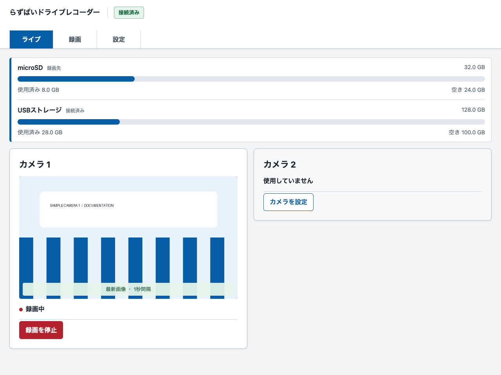
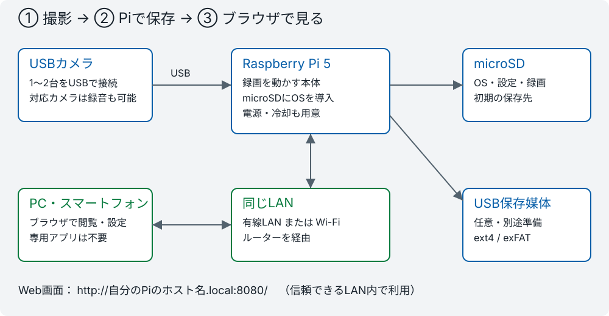
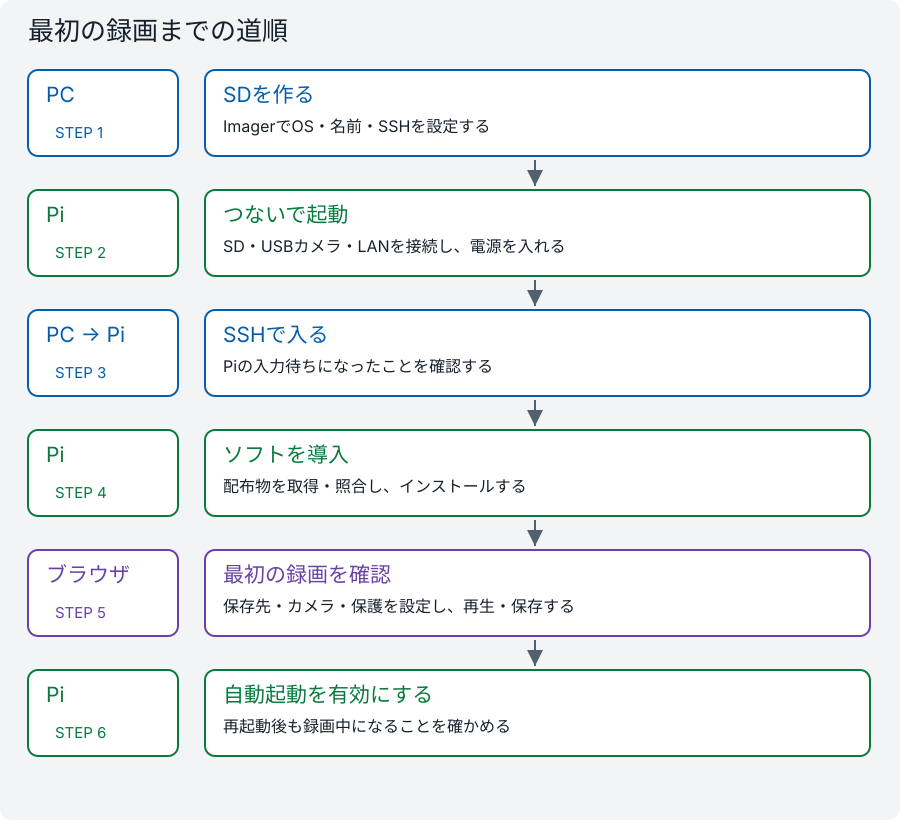
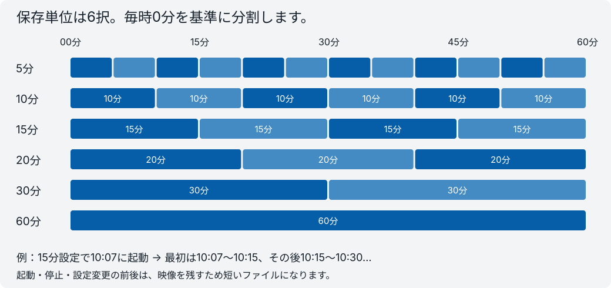
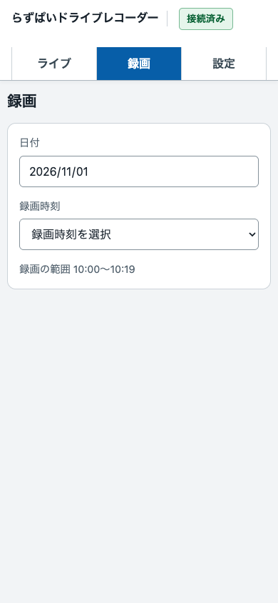

# らずぱいドライブレコーダー 概要説明書

対象：raspi-recorder 0.1.44の画面・仕様

USBカメラの映像をRaspberry Piに保存し、PCやスマートフォンのブラウザから見るソフトウェアです。**録画をするのはPi、画面を操作するのはPC・スマートフォン**です。

本書では、できること・必要な物・導入の流れを確認します。初めて使う方は、本書 → [インストール説明書](インストール説明書.md) → [取扱説明書](取扱説明書.md)の順に進んでください。

> **掲載画面について**
画面画像は説明用の表示例です。[画像について](images/manual/README.md)も参照してください。

## 目次

- [1. まず、何ができるか](#1-まず何ができるか)
- [2. 何と何をつなぐか](#2-何と何をつなぐか)
- [3. 用意する物](#3-用意する物)
- [4. 導入してから最初の録画を見るまで](#4-導入してから最初の録画を見るまで)
- [5. 録画ファイルはどう分かれるか](#5-録画ファイルはどう分かれるか)
- [6. 大切な録画を残すには](#6-大切な録画を残すには)
- [7. 使う前に知っておくこと](#7-使う前に知っておくこと)
- [8. 言葉が分からないとき](#8-言葉が分からないとき)
- [9. 説明書・配布元・ライセンス](#9-説明書配布元ライセンス)

## 1. まず、何ができるか

例えば、作業場所を1台のカメラで記録する場合は次のように使います。

| したいこと | 操作する場所 | できること |
|---|---|---|
| 撮影の向きや現在の様子を確かめたい | ライブ | 1秒間隔の最新画像と録画状態を見る |
| 後で作業を見返したい | 録画 | 日付と録画区間をリストで選んで再生する |
| 必要な映像をPCへ残したい | 録画 → ダウンロード | 選んだMP4をPC・スマートフォンへ保存する |
| ファイルを15分ずつ保存したい | 設定 → 録画の保存単位 | 5・10・15・20・30・60分から選ぶ |
| 音も記録したい | 設定 → カメラ | 対応マイクを選び、録画に音声を保存する |
| 電源を入れたら録画したい | 導入時の自動起動設定 | Pi起動時に録画とWeb画面を開始する |

**最初に見るのは、カメラ画像の下の「録画中」です。** 保存結果は、導入時に録画を確定させ、再生とダウンロードで確認します。

ライブ画面は画像表示のみで、音声は再生しません。録画音声は、保存済みの録画を再生して確認します。

## 2. 何と何をつなぐか

| 図の場所 | 役割 | 初めての方が確認すること |
|---|---|---|
| USBカメラ | 映像をPiへ送る | カメラはPiへ差す。閲覧用PCへ差すものではない |
| Raspberry Pi | 録画・設定・Web画面を動かす本体 | 安定した電源と冷却が必要 |
| microSD | OS・プログラム・設定・録画を保存する | OSを書き込むと中身が消えるため、新品か消去してよいカードを用意 |
| USB保存媒体 | 録画の保存先を別にする場合に使用 | 任意。形式・マウント・権限の準備が必要 |
| PC・スマートフォン | Web画面の操作と映像の取得 | Piと同じLANへ接続する |

図は接続関係を示したもので、基板上の差込口の位置を示す配線図ではありません。

Piにディスプレイやキーボードを常設する必要はありません。導入時はPCからSSHで接続し、導入後はブラウザを使います。ブラウザを閉じても、Piの録画処理が動いていれば録画は続きます。

通常の録画・LAN内の閲覧では、録画映像をクラウドへ送信しません。初回導入、更新、インターネット経由の時刻同期にはインターネット接続が必要です。

## 3. 用意する物

| 必要な物 | 条件と用途 |
|---|---|
| Raspberry Pi | Raspberry Pi 5、メモリー4GB以上 |
| OS | Raspberry Pi OS Lite 64-bit、Debian 13（Trixie）、Python 3.13 |
| 電源・冷却 | PiとUSB機器に見合う安定した電源、適切な冷却 |
| microSDとカードリーダー | OS・ソフトウェア・必要な録画量を保存できるカード。PCからOSを書き込む |
| USBカメラ | LinuxのV4L2で認識し、MJPEG／YUYVの対応設定を選べるもの。最大2台 |
| ネットワーク | 有線LANまたはWi-Fi。PCとPiが相互に接続できること |
| 導入用PC | Windows PCまたはMac。SD作成・SSH接続に使う |
| 音声入力（任意） | 選択したカメラと同じUSB親ポートに属する、対応する音声入力 |
| USB保存媒体（任意） | ext4またはexFAT。OSでマウントし、録画用の書き込み権限を準備する |

すべてのカメラ、マイク、USBハブ、保存媒体、ブラウザでの動作を保証するものではありません。導入した組合せで録画・再生・必要な音声・再起動後の動作を確認してください。

**最初はカメラ1台・microSD保存で確認すると、確認箇所を絞れます。** USB保存先や2台目は、最初の録画を再生できてから追加できます。重要な録画はSDだけに残さず、別の媒体へコピーします。

### 初期設定はどうなっているか

| 項目 | 初期値 |
|---|---|
| カメラ | 未登録。ブラウザの設定から使用カメラを選ぶ |
| 保存先 | microSD |
| 保存単位 | 5分 |
| 通常の録画設定 | 初期候補は1280×720・15fps・標準画質。カメラの対応設定により異なる |
| 録画音声 | OFF |
| 日時の焼き込み | ON |
| 省電力モード | OFF |
| ログイン保護・管理者保護 | 両方OFF。初期パスワードなし |
| 自動起動 | インストーラーだけでは有効にならない。動作確認後に有効にする |

## 4. 導入してから最初の録画を見るまで

[インストール説明書](インストール説明書.md)には、各工程で入力するコマンドと、成功したときの表示を載せています。ソフトウェアのプログラムを書く作業はありません。

| 今の状態 | 次に読む場所 |
|---|---|
| 初めてPiを用意した | インストール説明書の最初から |
| OSを書き込んだが接続できない | インストール説明書 第4章と第11章 |
| インストール済みで画面を開きたい | 取扱説明書 第2章 |
| すでに使っているPiを更新したい | 取扱説明書 第7章。OS用SDの作成は行わない |

## 5. 録画ファイルはどう分かれるか

保存単位を **5・10・15・20・30・60分**から選びます。毎時0分を基準に区切るため、15分なら00・15・30・45分、20分なら00・20・40分、60分なら毎時00分です。

起動、録画の停止・再開、設定変更、音声入力の切り替わり等の前後は、映像を残すため短いファイルになる場合があります。例えば15分設定で10:07に起動すると、最初は10:07から10:15まで、その後は10:15から10:30までという区切りになります。

録画を探すときは、日付を選び、**実際に保存された区間をリストから1つ選ぶ**だけです。時・分を別々に選んだり、時刻を手入力したりする必要はありません。

## 6. 大切な録画を残すには

選択した保存先の空き容量が減ると、古い正常確定済み録画から自動削除します。初期値は「削除開始5GB・回復目標7GB」です。さらに空きが減ると、録画を停止して媒体を保護します。

**録画を削除対象から外す固定・ロック機能はありません。** 必要な映像は自動削除される前にダウンロードし、コピーしたファイルも再生できることを確かめてください。

録画可能な日数は、カメラ台数、解像度、fps、画質、音声、撮影内容、空き容量によって変わります。保存単位を長くしても、その設定だけで必要な容量が一定になるわけではありません。

## 7. 使う前に知っておくこと

- **電源と媒体：** 電源断、給電不足、発熱、USB切断、媒体の故障や容量不足、設定誤りなどで、録画停止・映像や音声の欠落・破損・消失が起こり得ます。停止や復旧のすべてを自動で解決するものではありません。
- **ネットワーク：** Web画面はHTTPです。パスワードを設定しても通信は暗号化されません。信頼できるLANまたは保護されたVPN内で使用し、8080番をインターネットへ直接公開しないでください。
- **保護設定：** 新規導入時は保護OFFです。接続できる人が閲覧・停止・設定変更・映像取得を行えるため、通常運用前にログイン保護と管理者保護を設定してください。
- **撮影と録音：** 撮影場所の規則、関係者への説明や同意、映像・音声・保存媒体の取扱いを確認してください。保存媒体は自動で暗号化されません。
- **用途：** 一般用途の映像記録ソフトウェアです。車両専用の認証済み記録装置や、安全制御装置ではありません。非常停止、人身安全、設備保護などに必要な停止・保護は独立した機器・回路で確保してください。MIT Licenseに用途制限を追加するものではありません。
- **保証の範囲：** 録画の完全性、連続性、事故時の確実な記録、時刻の正確性、映像の証拠能力や改ざんされていないことを保証しません。

## 8. 言葉が分からないとき

| 言葉 | 本書での意味 |
|---|---|
| OS | Piそのものを動かす基本ソフト |
| Imager | PCでmicroSDにOSを書き込む公式アプリ |
| LAN | PiとPC・スマートフォンが接続する身近なネットワーク |
| ホスト名／IPアドレス | LAN内でPiを指定する名前／番号 |
| SSH／ターミナル | PCからPiに接続し、文字の命令を入力する方法／画面 |
| GUI／CLI | ボタンなどで操作する画面／文字の命令で操作する画面 |
| MP4 | ダウンロードする録画ファイルの形式 |
| fps | 1秒間に撮影する画像の枚数 |
| マウント | OSから保存媒体を使える状態にすること |

## 9. 説明書・配布元・ライセンス

| 説明書 | 内容 |
|---|---|
| [インストール説明書](インストール説明書.md) | OS作成、接続、導入、初回設定、最初の録画、自動起動 |
| [取扱説明書](取扱説明書.md) | ライブ、録画区間の選択、再生・保存、各種設定、点検、困ったとき |
| [GitHubリポジトリ](https://github.com/raspikoubou/raspi-recorder) | ソースコードと説明書 |
| [GitHub Releases](https://github.com/raspikoubou/raspi-recorder/releases/latest) | 公開安定版の導入ファイル |

本体は[MIT License](../../LICENSE)に基づく無償OSSです。「現状のまま」提供され、法令で認められる範囲で保証をせず、利用等に起因する損害について著作者・著作権者は責任を負いません。正式な条件はLICENSE本文を確認してください。OS、FFmpeg、PyAVなどの第三者ソフトウェアには、それぞれの条件が適用されます。[第三者ライセンス](../../THIRD_PARTY_NOTICES.md)も参照してください。
