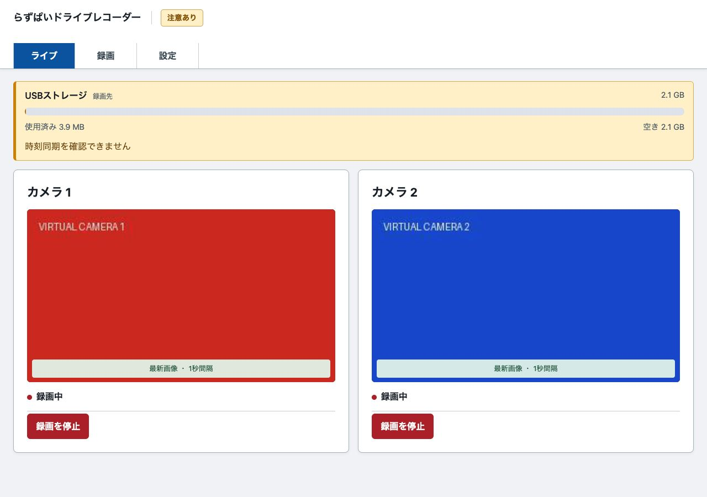
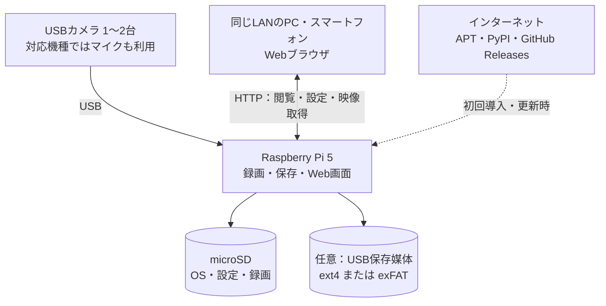

# らずぱいドライブレコーダー 概要説明書

対象：raspi-recorder 0.1.37の機能／GitHub Releasesで配布する安定版

本書は「何ができるか」「何を用意するか」「どのような制約があるか」を説明します。初めて導入する方は、本書を読んでから[インストール説明書](インストール説明書.md)へ進んでください。導入済みの機器を操作する方は[取扱説明書](取扱説明書.md)を参照してください。

## 1. どのようなソフトウェアか

Raspberry PiとUSBカメラを使い、映像をMP4ファイルに保存するソフトウェアです。同じLANに接続したPCやスマートフォンのブラウザから、現在の画像を見たり、録画を探して再生・保存したりできます。カメラは最大2台を個別に設定します。

「らずぱいドライブレコーダー」という名称ですが、車両専用の認証済み記録装置ではありません。設備や作業の映像記録など、一般用途を想定しています。録画の連続性や事故時の確実な記録を保証する製品ではありません。

### 利用例

| したいこと | 使う機能 | 注意すること |
|---|---|---|
| 作業場所を継続して撮影する | 常時録画 | 空き容量が減ると古い録画を自動削除する |
| 現在のカメラの向きを確認する | ライブの最新画像 | 通常表示は1秒間隔の画像更新。録画のfpsとは別 |
| 昨日の特定時刻を見たい | 日付・時間の選択と再生 | Piの時刻・タイムゾーンが正しく設定されていることが前提 |
| 必要な映像をPCに残す | MP4のダウンロード | 自動削除される前に別の媒体へ保存する |

*常時録画用の画面を、模擬データを使って撮影した表示例です。赤・青の画像は説明用です。上部の「時刻同期を確認できません」は撮影環境の状態であり、正常運用時に無視してよい表示という意味ではありません。*

## 2. システム構成

映像・設定・録画の一覧情報は、Piまたは選択したUSB保存媒体に保存します。録画映像や利用状況を開発元へ自動送信する機能はありません。通常の録画とLAN内での閲覧にはインターネット接続は不要ですが、初回導入、ソフトウェア更新、インターネット経由の時刻同期には接続が必要です。

閲覧用PCに録画ソフトを入れる必要はありません。ブラウザを閉じても、Piで録画処理が動作していれば録画は続きます。反対に、画像が画面に見えているだけでは、録画の成功を確認したことにはなりません。「録画状態」と保存されたファイルの再生も確認してください。

## 3. 用意する物と基準環境

| 項目 | 条件・用途 |
|---|---|
| Raspberry Pi | Raspberry Pi 5、メモリー4GB以上 |
| OS | Raspberry Pi OS Lite 64-bit、Debian 13（Trixie） |
| Python | 3.13。通常は指定OSに付属するものを使用 |
| 電源・冷却 | Piと接続するUSB機器の消費電力に見合う安定した電源、適切な冷却 |
| microSD | OS・ソフトウェア・必要な録画量を保存できるもの。初回作成にはカードリーダーも必要 |
| USBカメラ | LinuxのV4L2で認識され、ソフトが列挙するMJPEG／YUYVの対応設定を選べるもの。最大2台 |
| 音声入力 | 任意。選択したカメラと同じUSB親ポートに属する、対応するALSAキャプチャー機器 |
| USB保存媒体 | 任意。ext4またはexFATで、OSから書き込み可能にマウントされ、UUIDを確認できるもの |
| 導入用PC | Windows PCまたはMac。SD作成、SSH接続、必要に応じたファイル転送に使用 |
| 閲覧端末 | Piと同じLANのPC・スマートフォン。動画再生にはH.264対応ブラウザを使用 |
| ネットワーク | 有線LANまたはWi-Fi。外部へ直接公開しない、管理されたネットワーク |

これは基準環境です。すべてのカメラ、マイク、USBハブ、電源、保存媒体、ブラウザの組合せを保証するものではありません。導入先の機器で、録画・再生・音声・再起動後の動作を確認してください。

初期候補は1280×720・15fps・標準画質です。実際に選べる設定はカメラによって異なります。音声と省電力モードは初期OFF、日時焼き込みは初期ONです。解像度やfpsを上げるほど、処理負荷・発熱・保存量が増える傾向があります。

## 4. 録画の仕組み

カメラごとに映像を続けて保存します。Piの時刻で00・05・10分…を境にMP4へ分割します。開始・停止や設定変更の際は短いファイルになる場合があります。

保存した録画は「日付」と「時間」で選び、ブラウザで再生・ダウンロードできます。重要な録画は、自動削除される前に別の媒体へ保存してください。

## 5. 画面と主な機能

| 画面 | できること | 詳しい説明 |
|---|---|---|
| ライブ | カメラの最新画像、録画状態・停止理由、カメラ別の停止／再開 | [取扱説明書 第3章](取扱説明書.md#3-ライブ画面) |
| 録画 | 日付・時間の選択、再生、MP4のダウンロード | [取扱説明書 第4章](取扱説明書.md#4-録画を探す再生する持ち出す) |
| 設定 | 省電力、保存先・容量、カメラ・音声・日時表示、保護設定、時計、更新 | [取扱説明書 第5章](取扱説明書.md#5-設定を変更する) |

通常のライブは1秒ごとの画像更新です。録画を低fpsに変更する操作ではありません。音声付きライブは、音声を有効にしたカメラで、利用者が「音声付きライブを準備」を押して開始します。

## 6. 保存容量と大切な録画

保存先はmicroSDまたは選択したUSB媒体です。USBはext4／exFATに対応し、FAT32／NTFSは対象外です。本ソフトにフォーマット機能はありません。USBを挿すだけで、必ず保存先として選べるとは限りません。

空き容量が設定値を下回ると、選択した保存先の古い正常確定済み録画から自動削除します。初期値は「削除開始5GB・回復目標7GB」です。さらに空きが減り、microSDで2GB以下、USBで1GB以下になると録画を停止します。保護対象や異常ファイルが多い場合、削除しても空きを確保できないことがあります。

**重要な録画を消さないための固定・ロック機能はありません。** 必要な映像は早めにPCや別の媒体へダウンロードし、そのコピーが実際に再生できることを確認してください。MP4の取得は、設定・認証情報・一覧データベースまで復元するための完全なバックアップではありません。

録画可能な日数は固定ではありません。カメラ台数、解像度、fps、画質、音声、撮影内容、他のファイルによって変わります。導入先で実際の保存量を測定して計画してください。

## 7. セキュリティとプライバシー

新規導入時は「ログイン保護」「管理者保護」が両方OFFです。初期パスワードはありません。そのままでは接続可能な人が映像を閲覧・取得したり、録画の停止、設定変更、削除などを行えます。通常運用前に両方の保護を設定することを推奨します。

| 保護 | 主な対象 | 保護しないこと |
|---|---|---|
| ログイン保護 | 閲覧・再生・録画の停止／再開・映像取得 | 通信の暗号化、接続先端末の安全性 |
| 管理者保護 | 設定保存・削除・時刻変更・更新適用・認証変更 | Piを直接操作できる人やOS管理者による操作 |

Web画面はHTTPです。パスワードを設定しても通信は暗号化されず、ネットワーク上の第三者に映像や認証情報を盗み見・改変されるリスクが残ります。信頼できるLANまたは適切に保護されたVPN内で使用し、ルーターのポート転送などで8080番をインターネットへ直接公開しないでください。HTTPSを設ける場合は、管理者が認証・暗号化・接続元制限を含む構成を別途整備します。

撮影・録音・保存・共有には、設置場所の規則、関係者の同意、個人情報や機密情報の取扱いを確認してください。ダウンロードした映像、USB媒体、microSDも漏えいの対象です。アプリは保存媒体を自動で暗号化しません。詳しい対策とパスワードを忘れた場合の手順は[取扱説明書 第6章](取扱説明書.md#6-セキュリティとパスワード)を参照してください。

## 8. 使用上の注意・免責

- **安全制御の代わりにしないでください。** 本ソフトは一般用途の映像記録用です。非常停止、人身安全、設備保護、異常検知の確実性が必要な用途に必要な信頼性を保証しません。必要な停止・保護は独立した機器・回路で確保してください。これは安全上の注意であり、MIT Licenseに用途制限を追加するものではありません。
- **録画や復旧の成功を保証しません。** 停電、電源不足、過熱、USB切断、媒体の故障・寿命、容量不足、OS・ソフトの停止、高負荷、設定誤りなどで、映像・音声の欠落、破損、消失、録画停止が起こり得ます。自動再開や更新時の復旧処理も、すべての故障からの回復を保証しません。
- **画面の正常表示だけでは完全性を保証しません。** 見落とした欠落が必ず警告されるとは限りません。時刻同期未確認の映像の日時を、正確な発生時刻と断定しないでください。映像の証拠能力や改ざんがないことを証明する機能はありません。

本ソフトウェアは[MIT License](../../LICENSE)に基づき「現状のまま」提供されます。法令で認められる範囲で、商品性、特定目的への適合性、権利非侵害などの保証をせず、利用等に起因する損害について著作者・著作権者は責任を負いません。正式な条件はLICENSE本文を確認してください。説明書の手順や試験結果が、無欠陥・無停止・特定構成での動作を保証するものではありません。

## 9. 次に読む説明書

| 状況 | 読む説明書 |
|---|---|
| 新しいPiとmicroSDから始める | [インストール説明書](インストール説明書.md) |
| 導入済みで、映像を見たい・設定したい | [取扱説明書](取扱説明書.md) |
| 配布物やソース、ライセンスを確認したい | [GitHub](https://github.com/raspikoubou/raspi-recorder)・[安定版Releases](https://github.com/raspikoubou/raspi-recorder/releases/latest)・[第三者ライセンス](../../THIRD_PARTY_NOTICES.md) |

本体はMIT Licenseのソフトウェアです。OS、FFmpeg、PyAV、HLS.jsなどの第三者ソフトウェアには、それぞれの条件が適用されます。本体のMIT表記が第三者のライセンスを置き換えるものではありません。
